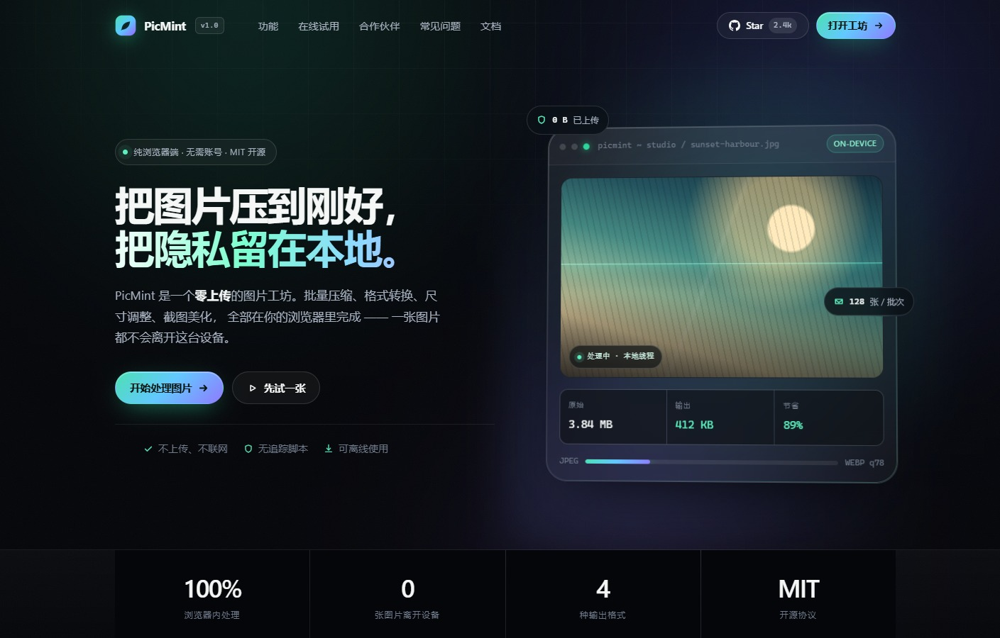
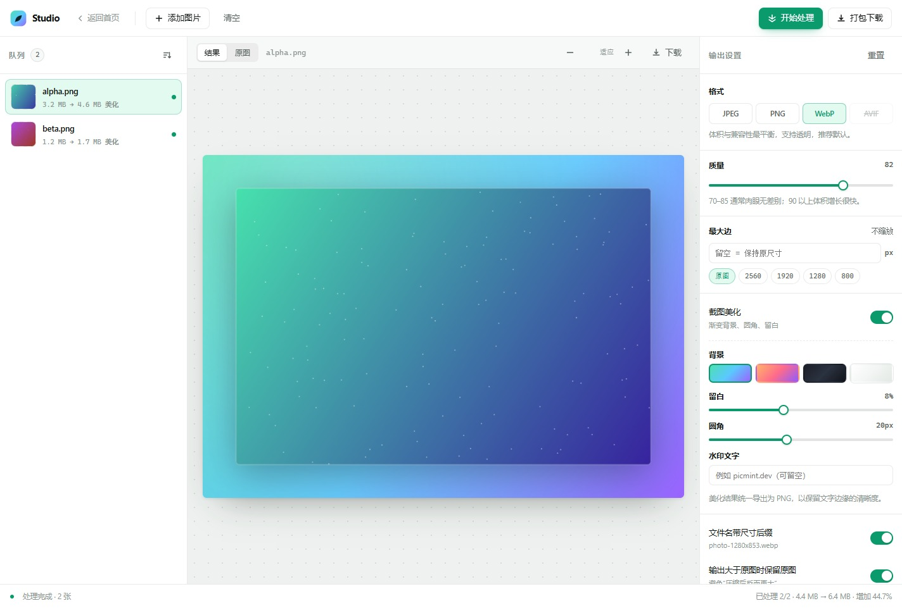

<div align="center">


# PicMint

**An image studio that runs in your browser. Batch compress, convert and beautify — nothing ever leaves your device.**

[](LICENSE)
[](package.json)
[](#how-it-works)
[](CONTRIBUTING.md)

[Live demo](https://picmint.dev) · [Quick start](docs/quick-start.md) · [Architecture](docs/architecture.md) · [Changelog](CHANGELOG.md) · [中文](README.md)

</div>



---

## Why

Every "free online image compressor" asks you to upload the original first. PicMint flips that: all decoding, resizing and encoding happens inside the tab. There is no backend to trust, because there is no backend.

| Typical online tool | PicMint |
| --- | --- |
| Uploads your image to a server | Stays in local memory |
| Waits for upload / download | Instant, limited only by your CPU |
| Breaks when the service shuts down | Static site, works offline |
| "We never store your files" | Nothing to store — no server exists |
| Quotas, sign-in, watermarks | Unlimited, anonymous, clean output |

## Features



- **Batch compression** — drop up to 128 images, compress by quality, watch before/after sizes update live.
- **Four output formats** — JPEG, PNG, WebP and AVIF via the browser's own encoders.
- **Smart resizing** — set the longest edge only; the other side follows. EXIF orientation is respected and images are never upscaled.
- **Screenshot beautification** — gradient backdrop, rounded corners, padding, soft shadow and a watermark, applied to the whole batch.
- **One-click ZIP** — a hand-written 90-line ZIP writer with UTF-8 filename support and no dependencies.
- **Local-first** — no cookies, no analytics, no font CDN, no network calls after page load.
- **Keyboard friendly** — `Ctrl/⌘ + O` to add, `Enter` to process, `Delete` to remove.

## Quick start

Requires Node.js 18+. **No `npm install` needed** — the project has zero dependencies.

```bash
git clone https://github.com/picmint/picmint.git
cd picmint
npm start
# → http://127.0.0.1:4173
```

Run the tests:

```bash
npm test
```

## Usage

1. **Drop images** anywhere in the studio window, or press `Ctrl/⌘ + O`.
2. **Pick output settings** on the right: format, quality, max edge. Enable *Screenshot beautify* for social-ready cards.
3. **Process** with the button in the top right (or `Enter`).
4. **Export** a single file, or download everything as a ZIP.

If the output would be larger than the source (a JPEG converted to PNG, for example), PicMint keeps the original and labels the row instead of silently wasting bytes.

## How it works

Plain JavaScript, no framework, no bundler, no polyfills.

| Concern | Approach |
| --- | --- |
| Decode | `createImageBitmap()`, falling back to `` + object URL |
| Resize | `canvas.drawImage` with `imageSmoothingQuality: 'high'` |
| Encode | `canvas.toBlob(mime, quality)`; PNG ignores quality |
| Capability probe | 2×2 canvas `toDataURL` prefix check for WebP / AVIF |
| Batch export | Stored (method 0) ZIP: local headers + central directory + EOCD + CRC32 |
| State | One plain `state` object; the queue re-renders, single rows are patched in place |

The ZIP is stored rather than deflated on purpose: images are already compressed, so deflate saves 1–3% at the cost of tens of kilobytes of JavaScript.

## Project layout

```text
picmint/
├── index.html                  # marketing page with a live compression demo
├── studio.html                 # the studio app
├── assets/
│   ├── css/                    # design tokens, landing, studio
│   ├── js/                     # image-core, landing effects, demo, studio controller
│   └── img/                    # logo, favicon, social card
├── docs/                       # guides + README screenshots
├── scripts/serve.mjs           # zero-dependency static server
├── tests/core.test.mjs         # node:test unit tests
└── .github/workflows/          # CI and GitHub Pages
```

## Browser support

| Browser | Compress / convert | AVIF output |
| --- | --- | --- |
| Chrome / Edge 90+ | ✅ | ✅ (Edge 121+) |
| Safari 16.4+ | ✅ | ✅ |
| Firefox 100+ | ✅ | ❌ option hidden |

Unsupported encoders are disabled with an explanation rather than silently swapped for another format.

## Privacy

- No backend, no image `fetch`, no analytics.
- No cookies, no `localStorage`, no IndexedDB — refresh clears everything.
- Verify it yourself: open the Network panel, clear it, then drop an image. No new requests should appear.

## Deploy

The repository root *is* the static site:

- **GitHub Pages** — Settings → Pages → Source: `GitHub Actions`; pushes to `main` deploy automatically.
- **Netlify / Cloudflare Pages** — leave the build command empty, publish directory `/`.
- **Self-hosted** — drop the repo into any static server root.

## Roadmap

- [x] Batch compression and format conversion
- [x] Resizing with EXIF orientation
- [x] Screenshot beautification
- [x] ZIP export
- [ ] Target-file-size compression (binary search on quality)
- [ ] Saved presets
- [ ] Drag-to-reorder and filename templates
- [ ] Traditional Chinese and Japanese UI

## Partners

PicMint has zero server cost, but design, font licensing, cross-device testing and security review still need support. Partner slots are open: **hello@picmint.dev**

> The partner logos on the landing page are placeholders — swap the inline SVGs in `index.html`; no CSS changes required.

## Contributing

Issues and pull requests are welcome. Please read [CONTRIBUTING.md](CONTRIBUTING.md) first, and make sure `npm test` passes.

## License

[MIT](LICENSE) © PicMint contributors

The code is free for commercial and derivative use with attribution. **The name and logo are not part of that grant** — forks should ship under their own identity.
